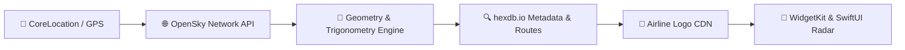

<div align="center">

# ✈️ SkyScan

### Real-Time Overhead Aircraft Tracker & Interactive Widgets for macOS & iOS

[](https://swift.org)
[-000000?logo=apple&logoColor=white)](https://apple.com/macos)
[](https://apple.com/ios)
[](https://developer.apple.com/widgets/)
[](LICENSE)

**SkyScan** turns your Mac desktop and iPhone Home Screen into an avionics radar display that detects planes flying directly above your head in real time.

[Features](#-features) • [Widget Layouts](#-widget-gallery) • [How It Works](#-how-it-works) • [Architecture](#-architecture) • [Getting Started](#-getting-started) • [Widget Setup](#-adding-the-widget)

</div>

---

## 🌟 Features

- **🎯 Precision Overhead Detection**: Uses trigonometric elevation angles and Haversine ground distance calculations. Planes flying directly overhead ($>35^\circ$ elevation angle or $<3$ miles ground distance) light up with an **`OVERHEAD`** glowing badge.
- **🏢 Official Airline Logos**: Downloads and renders crisp, transparent airline logos for major international airlines via global CDN.
- **✈️ Complete Flight Identity**:
  - **Airline Name & Logo** (e.g., *United Airlines*, *Delta Air Lines*, *British Airways*, *Lufthansa*)
  - **Flight Number** (e.g., `UA 1542`, `DL 883`, `BA 177`)
  - **Aircraft Model & Type Code** (e.g., `Boeing 777-200ER` / `B772`, `Airbus A321neo` / `A21N`)
  - **Tail Registration** (e.g., `N78013`, `G-XWBA`)
  - **Route Origin ➔ Destination** (e.g., `SFO ➔ JFK`, `LHR ➔ ORD`)
- **⚡ Interactive "Scan Sky" Button (iOS 17+ / macOS 14+)**: Powered by Swift `AppIntents`. Tap the reload icon directly on the widget face to refresh the sky instantly when you hear a plane outside—no need to launch the full app.
- **📡 Tactical Radar Scope (App)**: A full-screen radar canvas with continuous 360° sweep animations, range rings (5 to 50 mi), compass cardinal marks, and interactive aircraft blips.
- **📋 Dual-Mode Dashboard**: Seamlessly toggle between the animated **Radar Scope** and a real-time **Flight List**.
- **🔎 Flight Detail Inspector**: Tap any plane to view live telemetry (altitude, speed in knots, climb/descent rate, compass bearing, true track) with quick links to **Flightradar24** and **OpenSky Network**.
- **🧪 Airport Simulation & Demo Mode**: Built-in airspace presets for SFO, JFK, LHR, FRA, and HND, plus a demo mode for testing indoors or during low-traffic hours.

---

## 📱 Widget Gallery

SkyScan supports all standard Apple WidgetKit sizes on both macOS desktop and iOS Home Screen:

| Widget Size | Key Information Displayed |
| :--- | :--- |
| **Small (`systemSmall`)** | Airline Logo, Flight Number, Rotating Heading Icon, Altitude (`32,000 FT ↗`), Distance badge (`1.8 mi NE`), Speed, and interactive Scan button. |
| **Medium (`systemMedium`)** | Dual-pane avionics HUD: Miniature live **Radar Scope** on the left + Flight branding, Route banner (`SFO ➔ JFK`), Aircraft type, Altitude, Speed, and Elevation angle on the right. |
| **Large (`systemLarge`)** | Full tactical radar circle plotting all nearby aircraft relative to your center location, plus a live table of the top 3 closest overhead flights. |
| **Accessory (Lock Screen)** | Ultra-compact flight callsign, altitude, distance, and aircraft model for Lock Screen and macOS Menu Bar. |

---

## 🧠 How It Works

SkyScan combines raw ADS-B radio telemetry with metadata enrichment and trigonometry:



1. **Airspace Bounding Box**: Converts your coordinates and selected radius (default: 25 miles) into a dynamic latitude/longitude bounding box ($1^\circ\text{ lat} \approx 111\text{ km}$).
2. **ADS-B Telemetry**: Fetches live state vectors from the open-access **OpenSky Network** API, filtering out aircraft on the ground (`on_ground == false`).
3. **Overhead Elevation Math**:
   - **Haversine Distance**: Calculates the surface ground distance ($d$) from your location to the aircraft.
   - **Compass Bearing**: Calculates initial true bearing angle ($\theta$) converted to 16-point cardinal compass directions (`NNE`, `NE`, `ENE`, etc.).
   - **Elevation Angle**:
     $$\text{elevation} = \arctan\left(\frac{\text{altitude}}{\text{ground distance}}\right) \times \frac{180}{\pi}$$
     If $\text{elevation} \ge 35^\circ$ or $d < 3.0\text{ mi}$, the plane is classified as directly overhead.
4. **Aircraft & Route Enrichment**:
   - Resolves ICAO 24-bit transponder addresses (`Mode S`) via `hexdb.io` to retrieve the aircraft manufacturer, type model, and tail registration.
   - Queries callsign routes to determine scheduled origin and destination airport pairs (`KSFO-KJFK` $\rightarrow$ `SFO ➔ JFK`).
5. **Logo Rendering in WidgetKit**: Downloads raw PNG bytes during timeline generation so widgets render crisp airline logos offline directly on your desktop or Home Screen.

---

## 🏗️ Architecture

```
SkyScan/
├── project.yml                     # XcodeGen project specification
├── SkyScan.xcodeproj               # Ready-to-run Xcode project
├── Shared/                         # Shared core business logic
│   ├── Flight.swift                # Domain model, Haversine distance, elevation math
│   ├── OpenSkyService.swift        # OpenSky REST API client & parser
│   ├── AircraftEnrichmentService.swift # Metadata, route & logo fetcher
│   ├── AirlineDatabase.swift       # Global airline ICAO/IATA catalog & airport resolver
│   ├── AirlineLogoView.swift       # Multiplatform SwiftUI logo badge
│   ├── LocationManager.swift       # CoreLocation manager (macOS + iOS)
│   ├── RefreshFlightsIntent.swift  # AppIntent for interactive widget refresh
│   └── UserDefaults+Extensions.swift # App Group persistence & offline cache
├── SkyScan/                        # Main SwiftUI Application
│   ├── SkyScanApp.swift            # App entry point
│   ├── ContentView.swift           # Main radar & flight list dashboard
│   ├── RadarView.swift             # Animated 360° radar sweep canvas
│   ├── FlightDetailSheet.swift     # Flight stats inspector & external links
│   ├── SettingsView.swift          # Radius slider, presets & demo mode
│   ├── Info.plist                  # Permissions & usage descriptions
│   └── SkyScan.entitlements        # macOS sandbox, location & network entitlements
└── SkyScanWidget/                  # WidgetKit Extension
    ├── SkyScanWidgetBundle.swift   # Extension bundle declaration
    ├── SkyScanWidget.swift         # TimelineProvider & widget configuration
    ├── SkyScanWidgetViews.swift    # Small, Medium, Large & Accessory views + #Previews
    ├── Info.plist                  # Widget extension metadata
    └── SkyScanWidget.entitlements  # Widget sandbox & networking entitlements
```

---

## 🚀 Getting Started

### Prerequisites
- macOS Sonoma (14.0+) or macOS Sequoia
- Xcode 15.0+ with Swift 5.9+
- *(Optional)* [XcodeGen](https://github.com/yonaskolb/XcodeGen) (`brew install xcodegen`) if modifying `project.yml`

### Clone & Open
```bash
git clone https://github.com/godblessamki/SkyScan.git
cd SkyScan
open SkyScan.xcodeproj
```

---

## 🖥️ Adding the Widget

### macOS Desktop & Notification Center
1. In Xcode, select the **`SkyScan`** scheme and press **`Cmd + R`** to run.
2. The app will launch and register the widget with macOS LaunchServices. You can now close the app window.
3. **Right-click** anywhere on your desktop wallpaper $\rightarrow$ click **"Edit Widgets..."**.
4. In the widget drawer at the bottom of the screen, search for **"SkyScan"**.
5. Drag your preferred widget size onto your desktop!

### iOS Home Screen & Lock Screen
1. In Xcode, select the **`SkyScan-iOS`** scheme.
2. Choose your connected iPhone or an iOS Simulator and press **`Cmd + R`**.
3. On your iPhone, long-press the **Home Screen** until app icons jiggle.
4. Tap the **`+`** button in the top corner, search for **"SkyScan"**, and tap **Add Widget**.

---

## ⚙️ Configuration & Customization

Inside the SkyScan app settings (`⚙️` button in the top-right toolbar):
- **Search Radius**: Adjust detection distance from **5 miles to 50 miles** (slider).
- **Location Source**: Use your live GPS coordinates or pick from major international airport presets (*SFO, JFK, LHR, FRA, HND*).
- **Demo Mode**: Toggle simulated aircraft to test widgets and radar animations at night or indoors.

---

## 🌐 Data Sources & Attribution

- **Flight Radar Telemetry**: [OpenSky Network](https://opensky-network.org/) — Community-driven, non-profit ADS-B receiver network.
- **Aircraft Metadata & Routes**: [hexdb.io](https://hexdb.io/) — Open community aircraft transponder and route database.
- **Airline Brand Assets**: High-resolution transparent airline logotypes provided by public airline CDNs.

---

## 📄 License

This project is licensed under the MIT License — see the [LICENSE](LICENSE) file for details.
